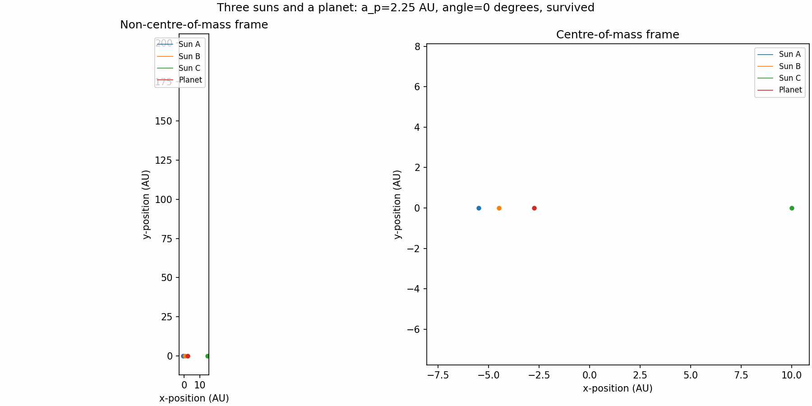
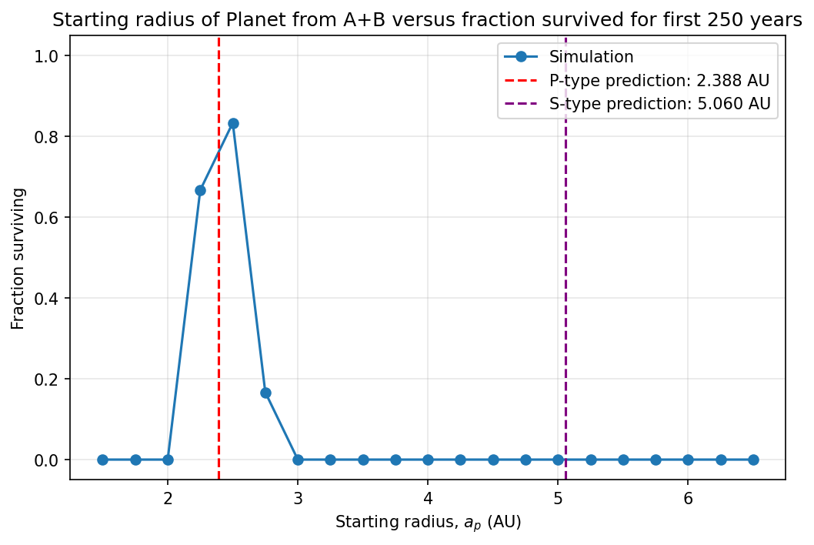

# N-Body-Engine and the Three Body Problem

## 1. Research question

In a 4-Body-System consisting of 3 Suns and 1 Planet, at what starting radius away from a binary star system does the planet remain in a long-term stable orbit of 250 years, given all bodies initialize with circular velocity?

## 2. Model and method

I modelled the system as point masses moving in a plane under Newtonian gravity. I used AU, years and solar masses, so $G = 4\pi^2\,\mathrm{AU^3}\,M_\odot^{-1}\,\mathrm{yr^{-2}}$. For each body $i$, with position $\mathbf r_i$ and velocity $\mathbf v_i$, the equations are

$$\frac{d\mathbf r_i}{dt} = \mathbf v_i$$

$$\frac{d\mathbf v_i}{dt} = G\sum_{j\ne i} m_j \frac{\mathbf r_j - \mathbf r_i}{|\mathbf r_j - \mathbf r_i|^3}$$

The state vector stores all positions first and then all velocities: $[x_0,y_0,x_1,y_1,\ldots,v_{x,0},v_{y,0},v_{x,1},v_{y,1},\ldots]$. The three suns have masses $1\,M_\odot$ and the planet has mass $3\times10^{-6}\,M_\odot$. Suns A and B begin 1 AU apart with opposite tangential velocities, while C begins $15$ AU away with the approximate circular speed $\sqrt{G(M_A+M_B)/15}$. The planet begins at radius $a_p$ from the A+B centre at the selected angle, with tangential speed $\sqrt{G(M_A+M_B)/a_p}$. These initial conditions assume initially circular motion between A+B, Planet and A+B, and C and A_B. Bodies are treated as point masses.

I integrated the first-order system with scipy.integrate.solve_ivp. I used the default RK45 method with rtol=10^{-10} and the default absolute tolerance. The survival runs use a terminal event that returns the minimum signed distance to the limits $a_p/3$ and $3a_p$, thus integration stops when the planet first leaves that interval.

## 3. Validation

I checked the numerical model against analytical orbital results, conservation laws and solver/tolerance comparisons.

**Analytical orbital checks.** For a massless planet orbiting a $1\,M_\odot$ sun, the circular speed is
$$v=\sqrt{GM/r},$$
and Kepler's third law is $T^2=a^3/M$. With $a=1$ AU and $M=1\,M_\odot$, the predicted period is $1$ year. The event-detected numerical period was $0.99999997$ years, differing by only $3.44\times10^{-8}$ years. I then started the planet at $1.2$ times the circular speed, producing an ellipse. Using the vis-viva equation and Kepler's Third Law the analytical period was predicted to be $T=2.3862610885$ years. The numerical period was $2.3862613483$ years, a difference of $2.598\times10^{-7}$ years.

**Solver and tolerance checks.** I integrated the 100-year elliptical test with the default RK45 method. Every run had sol.status = 0 (thus reaching desired final time). The final fractional energy drift was 0.0072% for rtol = 1e-10.

**Three-sun orbital checks.** For the equal-mass A+B pair separated by 1 AU, Kepler's law predicts
$$T_{AB}=\sqrt{\frac{a_{AB}^3}{m_A+m_B}}=\frac{1}{\sqrt{2}}=0.70711\,\mathrm{yr}.$$
The numerical A-B periods were $0.70697$ years initially, $0.70529$ years finally, with a minimum of $0.70463$ and a maximum of $0.70779$ years. The A-B separation began at 1 AU and varied only from 0.99652 to 1.00182 AU. The small variation is expected from perturbations by C and the planet, together with numerical error.

**Conservation checks.** For the full A, B, C and planet system over 250 years, I calculated the total energy
$$E=\sum_i\frac12m_i|\mathbf v_i|^2-\sum_{i<j}\frac{Gm_im_j}{r_{ij}},$$
the total momentum $\mathbf P=\sum_i m_i\mathbf v_i$, and the planar angular momentum
$$L_z=\sum_i m_i(x_iv_{y,i}-y_iv_{x,i}).$$
The fractional energy change was 0.1953%, the fractional angular-momentum change was 0.0186%, and the final momentum change had magnitude $3.26\times10^{-16}$. These small changes show that the numerical integration preserves the expected invariants well.

## 4. Key result

**Figure 1.** Fraction of the six tested starting angles that remain within $a_p/3$ and $3a_p$ of the A+B centre for the full 250-year integration, plotted against the planet's initial radius $a_p$. The transition at each edge is gradual because the three-body system is sensitive to the starting angle, so one radius can have both surviving and escaping runs.

## 5. Limitations and next step

Limitation: 250 years starting from the initial conditions is not enough time to determine a stable or surviving planet.

While the Holman--Wiegert P-type estimate of 2.39 AU agrees reasonably with the measured inner edge, its S-type estimate of 5.06 AU (for a Sun C at 15 AU) is farther out than my measured 250-year outer edge, because that fit describes long-term binary stability under idealized assumptions, whereas my test uses a finite 250-year interval and six discrete starting angles.

Moving C actually provides evidence of this. At 10 AU the perturbation is strong enough that no tested radius survives all 250 years, whereas at 20 AU the outer stable region expands and the simulations show 100% survival for the sampled radii from 2.5 to 3.25 AU.

The next step would be to measure for several thousand years, and see if there are any continous 250-year-long periods that exist in between those thousand years, or whether the planet settles into long-term stability. 

Another improvement would be to increase the number of starting angles, and decrease the radius increment in order to generate more tests and simulations. This would improve overall accuracy of the simulation.

## 6. Decision log

1. I used the default RK45 method with rtol = 1e-10. While the DOP853 method does minimize my total energy drift more, (0.05306 vs 0.00957 from Part 2), the plotted graphs produced are much more jagged. I use t_eval with 5000 points in between to fix this jaggedness. However, this results in a higher total energy drift than simply using default RK45 method. Thus, I go with using RK45 with rtol = 1e-10, which minimizes total energy drift and still being computationally fast.

2. I classified the planet using its instantaneous specific orbital energies relative to A+B and C. I used
$$\epsilon_{AB}=\frac12|\Delta\mathbf v_{AB}|^2-\frac{G(M_A+M_B)}{|\Delta\mathbf r_{AB}|},\qquad
\epsilon_C=\frac12|\Delta\mathbf v_C|^2-\frac{GM_C}{|\Delta\mathbf r_C|}.$$ 
I called the planet **bound to A+B** when $\epsilon_{AB}<0$ and it was closer to the A+B centre than to C. I called it **captured by C** when $\epsilon_C<0$ and it was closer to C than to A+B. I called it **escaped** when both energies were positive. Negative specific energy is the two-body criterion for a bound orbit, while the distance comparison assigns the bound state to the nearer potential well. I rejected using distance alone because a close approach does not necessarily mean the planet is energetically bound, and I rejected using only one energy because the planet can be bound to both approximations at the same time during an encounter.

3. I tested six starting angles, $0^\circ,60^\circ,120^\circ,180^\circ,240^\circ$ and $300^\circ$, because it offers the best selection to test all directions using just 6 angles, with equal increments.
